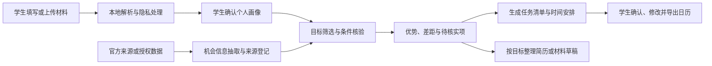

# 上海交通大学“交我创”智能体创新大赛——初赛作品设计方案

> **参赛赛道**：自由选题赛道  
> **智能体名称**：PathFinder SJTU｜交我成长导航  
> **参赛队伍**：星鹭企  
> **队伍成员**：胡昕宇、丁天宇、石璟阳  
> **联系邮箱**：1847627339@qq.com

## 一、智能体简介

PathFinder SJTU 面向上海交通大学学生，聚合经核验的校内通知、夏令营、海外项目与校招信息，结合个人经历和目标，提供机会检索、申请条件核对、能力差距分析及多线申请排期，并辅助整理简历和申请材料。每项关键信息标注来源与日期，帮助学生把分散信息转化为可执行计划。

## 二、建设背景与应用场景

### 2.1 建设背景

学生在推免、夏令营、海外项目申请和求职期间，通常需要在学院通知、项目官网、企业招聘页面及校内服务渠道之间反复查找信息。不同机会的申请条件、材料清单和截止时间格式不一；个人经历分散在简历、成绩单和项目材料中；多项申请并行时，还要预留成绩单、排名证明、在读证明和推荐信等材料的准备时间。信息遗漏、条件误读和日程冲突都会增加准备成本。

通用问答工具可以解释材料，却难以持续关联“学生背景—机会要求—准备任务—时间安排”，也可能把过期经验或模型推断误当成事实。PathFinder SJTU 因此聚焦一个连续场景：**发现机会、判断适配、安排准备、整理材料**，并以可追溯的信息来源和人工确认机制支撑建议。

### 2.2 目标用户与场景

- **本科生**：寻找推免夏令营、学科竞赛、海外交流和科研项目，核对申请门槛并安排准备任务。
- **研究生及毕业年级学生**：搜索企业校招和海外项目要求，比较岗位或项目与自身经历的匹配情况。
- **多线申请者**：集中查看申请截止日期、面试安排及校内证明、推荐信等前置事项，识别时间冲突。
- **材料准备者**：核对简历与用户提供的证明材料，按目标项目或岗位整理真实经历和申请材料草稿。

## 三、设计目标与功能范围

### 3.1 核心目标

将分散的机会信息和个人准备事项组织成可核验、可比较、可执行的申请计划。智能体提供信息整理和决策辅助，不替代学校部门、招生单位或用人单位作出正式判断。

### 3.2 核心功能

1. **机会信息检索与归档**：按类型、专业方向、地区、年级和截止时间检索校内通知、夏令营、海外项目及校招信息。每条信息保存标题、发布机构、原文链接、发布日期、截止日期、适用对象和材料要求等字段。
2. **个人画像与经历管理**：由学生填写或上传简历、成绩单及经历材料，提取专业、年级、成绩区间、语言成绩、科研、竞赛和实习经历，供学生校对后保存为个人画像。画像可随时修改或删除。
3. **目标匹配与条件核验**：将机会要求拆分为硬性条件与软性偏好，逐项对照画像，标记“已满足 / 待核实 / 存在差距 / 不满足”，说明判断依据、缺失信息和原始来源。对适配度提供解释性维度分析，不声称预测录取或录用结果。
4. **能力差距与准备建议**：围绕目标列出已有优势、需要补充或呈现的经历、尚待确认的要求，并生成用户可编辑的准备清单。图表用于展示个人经历与目标要求的覆盖情况，不输出虚假精确的成功率。
5. **多线申请排期与冲突提醒**：汇总用户选中的项目截止日期、笔试面试时间和准备任务；按用户确认的办理耗时，为成绩单、排名证明、在读证明、推荐信沟通等事项倒排提醒。允许用户修改任务时间，并支持导出 `.ics` 日历文件。
6. **简历及材料辅助**：基于用户提供并确认的真实经历，按目标岗位或项目整理简历要点、个人陈述提纲和材料检查表。对来源不明或无法核验的陈述进行标记，不补造奖项、论文、职责或成果。
7. **经验信息整理（审慎扩展）**：在获得合规访问条件时，检索水源社区公开且允许使用的相关讨论，概括经验主题，并保留帖子链接、发布时间及“个人经验、非官方要求”的标识。若数据不可稳定、合规获取，则由用户提供帖子链接或文本进行整理，不将其作为核心功能依赖。

### 3.3 初赛原型边界

为保障可行性，初赛原型建议优先完成一条闭环：**录入个人画像 → 导入或检索一组机会 → 条件核验 → 生成申请待办和日历文件**。信息范围可先选定若干公开来源和两至三类机会（如校内竞赛、夏令营、企业校招），使用公开样例或经授权的脱敏数据演示。

全校通知、实时课表同步、自动监控全部外部网站、水源社区全量采集及自动代办校内手续均列为后续拓展，需在获得相应接口、授权和稳定数据源后再实施。

## 四、设计框架

### 4.1 系统模块

- **交互层**：提供画像问卷、机会搜索、目标选择、材料上传、报告查看及日程导出界面。
- **数据接入层**：接入经授权的校内公开通知和公开项目/招聘页面；支持人工录入、管理员维护及用户粘贴链接或文本。为每条数据记录来源、抓取或录入时间和有效状态。
- **信息处理层**：完成网页/文档解析、字段抽取、重复项合并、日期标准化和过期标记。关键字段保留原文片段供核验。
- **个人画像与机会库**：分别保存经用户确认的画像字段和机会结构化信息；按权限隔离个人数据与公共信息。
- **匹配与排期引擎**：由规则模块处理明确的硬性条件、日期和冲突；由检索与大模型模块处理文本语义、软性偏好解释和自然语言总结。
- **智能体编排层**：按“澄清目标—检索证据—核验条件—形成差距分析—生成计划—用户确认”调用工具。对缺少证据的判断明确标注不确定，不自行补全事实。
- **安全与审计层**：管理授权、脱敏、访问控制、日志和删除操作，并对模型输出及外部内容进行边界检查。

### 4.2 主要工作流

## 五、技术路线

1. **数据接入**：优先采用主办方、学校或信息发布单位提供的 API、公开页面及允许使用的文件；记录来源链接、发布时间、获取时间和版本。对没有稳定接口或不允许自动采集的站点，使用人工录入或用户提交材料，不绕过登录、访问控制或站点规则。
2. **文档解析与结构化**：对 PDF、Word 和网页内容进行文本抽取，必要时使用 OCR；将机会信息统一为结构化字段。日期、数字、资格条件等关键字段尽量通过确定性规则解析，并展示原文依据，供用户确认。
3. **检索增强生成（RAG）**：对已登记的机会文本建立关键词与向量检索；大模型基于检索到的原文解释要求、总结材料和生成建议。答案附来源和日期，未检索到依据时提示用户核实或补充，不凭空给出官方要求。
4. **规则与匹配**：硬性门槛采用可解释规则逐项比较；软性匹配根据专业方向、经历、兴趣与目标描述生成分项解释。分数或雷达图仅描述覆盖度和相对匹配维度，不等同录取概率。对缺少个人信息的字段标为“未知”，不默认通过。
5. **时间规划**：基于用户确认的截止日期、活动时间和前置任务耗时构建日程；用日期区间重叠检测识别冲突。校内业务办理时长由用户或经核实的校方信息配置，不将估算值表述为官方承诺。
6. **模型与部署**：优先使用赛事提供的“致远一号”本地大模型 API 和云主机；在模型能力不足或服务不可用时，保留规则核验、信息搜索和手工确认等基础流程。使用学校提供的 OpenJiuwen、AI Shell 或其他赛事允许的智能体框架完成工具编排，具体以赛事环境和接口可用性为准。
7. **验证方式**：使用公开或虚构样例检查字段抽取、条件核验、来源引用、过期提醒、日程冲突和材料草稿的可靠性；邀请少量目标用户试用，记录任务完成情况与误报/漏报，依据反馈调整规则和交互。

## 六、资源需求

- **算力与模型**：赛事提供的本地大模型 API；初期以轻量解析和检索为主，控制调用量。
- **部署环境**：致远一号云主机（如获批）、应用服务、关系型数据库及向量检索组件；原型阶段可采用简化部署。
- **数据来源**：学校及学院公开通知、项目官网、企业招聘官网、用户主动提供的材料；水源社区内容仅在符合平台规则和授权条件时接入。
- **开发工具**：文档解析/OCR、搜索与向量检索、日历文件生成、权限与日志组件；以及经赛事允许的智能体开发框架。
- **团队分工**：产品与场景调研、数据整理与规则设计、智能体/后端开发、前端与交互、测试与材料撰写。小队成员可兼任。
- **运营维护**：需要定期核对来源可用性、更新过期机会信息、回应用户反馈并维护明确的数据删除机制。

## 七、预期效果与评估指标

### 7.1 预期效果

- 减少学生在多个渠道间重复搜索和手工整理信息的时间。
- 将机会要求、个人条件和申请任务放在同一流程中，降低漏看条件和错过截止日期的风险。
- 让学生能区分官方要求、系统判断和社区经验，提升申请准备的可解释性。
- 形成可迁移的高校机会信息管理和个性化规划方案，为后续接入更多学院和校园服务打基础。

### 7.2 原型评估指标

初赛可用一组人工核验的公开机会样例进行评估：关键字段抽取准确情况、硬性条件判断与人工核对的一致情况、回答附带有效来源的比例、过期信息标记情况、冲突提醒正确情况、用户完成一次查询到计划导出的用时与主观满意度。指标阈值在样例集建立后确定，并如实报告，不预先承诺未测结果。

## 八、风险与伦理合规考虑

1. **信息过期或提取错误**：展示原始来源、发布时间、获取时间和截止日期；设置过期标记与人工复核入口。无法确认的信息标注“待核实”，不隐藏不确定性。
2. **匹配结果误导**：不宣称录取、录用概率，不把历史经验当成今年规则；将硬性条件与软性建议分开呈现，最终资格以发布单位最新通知为准。
3. **个人信息与敏感材料**：遵循最小必要原则；上传前提示用途和风险；对姓名、学号、联系方式等优先在本地脱敏；设置明确的临时存储期限、用户删除入口和访问权限。成绩单、身份证件等敏感文件不用于训练模型，不在演示中展示真实个人材料。
4. **数据来源与平台规则**：遵守网站及论坛的访问条款、版权和授权要求，不绕过登录或访问控制、不进行高频抓取、不收集无关个人信息。社区经验标注为非官方观点，并提供原帖链接与时间；未获授权时不批量采集或再分发。
5. **简历真实性与学术诚信**：仅改写用户提供并确认的经历，不生成虚构奖项、论文、实习、职责或成果；将草稿标注为待本人核对，避免自动提交。
6. **公平性与偏差**：不同专业、年级和经历背景的用户可能获得不均衡推荐。提供筛选条件说明和手动搜索入口，避免仅按单一排名或学校标签排除机会；定期抽查推荐差异。
7. **外部内容与提示注入**：把网页、论坛帖和上传文档视为待分析数据而非系统指令；限制外部内容调用工具和访问个人数据的权限，避免恶意文本影响智能体行为。
8. **校园服务边界**：通知、课表或证明办理进度若无正式接口，不宣称已与教务或校务系统打通；首期仅提供信息整理、用户手动录入和日历导出，不代替校内部门办理业务。

## 九、迭代计划

- **初赛阶段**：确定目标用户与数据范围，完成设计书、交互原型和小型样例集；展示从画像录入到条件核验、申请排期和日历导出的闭环。
- **决赛阶段**：接入获准的数据源，完善文档解析、规则核验、来源追溯、用户画像管理和安全控制；部署可供真实用户试用的版本，依据试用反馈优化。
- **后续拓展**：在数据授权、接口能力和隐私评估满足条件后，再扩展校园通知与活动聚合、课表同步、网页变更提醒和更多社区经验整理功能。

---

**作品定位一句话**：PathFinder SJTU 把交大学生的个人经历、升学求职机会与申请时间线连接起来，让每条建议有出处、每项准备有下一步。
