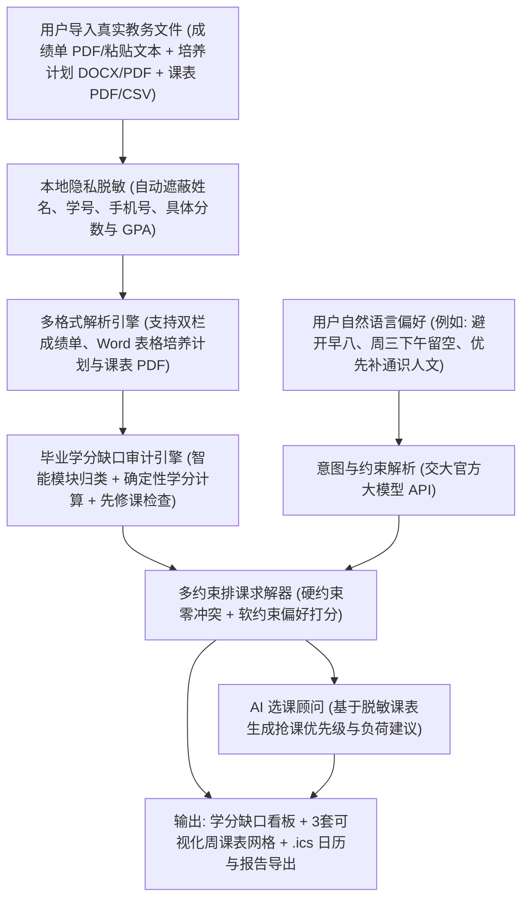
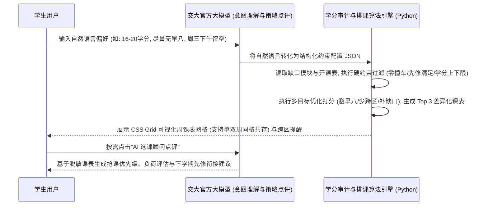

# 上海交通大学“交我创”智能体创新大赛——初赛作品设计方案

> **参赛赛道**：自由选题赛道（开放式命题）  
> **作品名称**：交大智排 —— 交大“培养方案核查与智能排课”智能体  
> **参赛队伍**：`[待填写：队伍名称]`  
> **队伍成员**：`[待填写：1-4名成员姓名、学院及分工]`  
> **联系邮箱**：`[待填写：队长交大邮箱]`  

---

## 一、 项目背景与痛点分析（场景实用性）

上海交通大学各学院的本科及研究生培养方案模块细分、选修自由度高，这虽然给了同学们充分的选课空间，但也让每学期的选课与毕业学分自查变成一件非常耗时且容易出错的事：

1. **培养方案模块复杂，人工核对极易漏修**  
   交大培养方案通常包含通识教育（公共课与人文/社科/自然/艺术等通识核心模块）、专业教育（基础/核心/选修）、实践教育、交叉模块与个性化模块。很多同学靠肉眼对照双栏成绩单 PDF 和几十页的 Word 培养计划算学分，一不小心就会漏掉某个细分模块，甚至拖到大四才发现毕业学分不够。
2. **先修课与学期开课限制容易踩坑**  
   很多专业核心课有严格的先修课要求，或者只在秋季/春季单学期开设。如果大二、大三没有提前规划好先修链条，很容易导致后续高阶课程选不上，打乱整个修读节奏。
3. **排课是个繁琐的多目标拼图，普通大模型算不准**  
   选课时不仅要保证上课时间不撞车、不超过学分上限，还要兼顾个人偏好（如“尽量避开早八”“周三下午留空参加社团/科研”“不要连续跨太远的教学楼赶课”）。如果直接让普通聊天大模型帮忙排课，大模型极易在星期、节次和单双周上产生幻觉，排出互相冲突的假课表。

**我们的思路**：  
打造一款专为交大师生设计的**“培养方案核查 + 智能排课”智能体**。我们不让大模型硬算时间和学分，而是采用**“交大官方大模型理解文档规则与自然语言偏好 + Python 确定性算法做学分审计与冲突求解”**的协作模式：直接兼容同学从教务系统下载的真实文件（**成绩单 PDF / 培养计划 DOCX / 课表 PDF**），数据完全在校内闭环，算得准、不瞎编，能直接生成多套无冲突的周课表方案。

---

## 二、 整体架构与核心功能设计（方案可行性）

系统依托大赛提供的**交大官方大模型 API（`models.sjtu.edu.cn`，支持 DeepSeek V4 Flash / Qwen3.8-27B）** 与校内云主机部署，核心由**本地隐私脱敏、多格式文档解析、学分审计引擎、多约束排课算法、AI 选课顾问**五个部分组成：

### 2.1 真实教务文件一键解析与毕业学分缺口核查（算得清）
- **全面适配交大真实文件格式**：
  - **个人成绩单**：支持直接上传教学信息服务网导出的**双栏成绩单 PDF**（自动处理换行课程名与“形势与政策”多学期累加），也支持直接复制粘贴成绩页文字或上传 CSV/Excel/DOCX。
  - **学院培养计划**：直接支持上传从教务网下载的 **Word (`.docx`)** 或 PDF 培养方案，自动提取正文与表格内容，并调用交大官方大模型抽取各模块所需学分、必修清单与先修关系。
- **智能归类与逐模块精准核对**：即使培养方案文档未逐一列出全部课程代码，系统也会自动将已修课程归类至对应培养模块，清晰列出每个模块的**“已修 / 要求 / 缺口学分”**，并对缺少先修课的课程自动预警拦截。

### 2.2 “大模型理解偏好 + 算法精确求解”的智能排课（排得准）
针对普通大模型排课容易“时间撞车”的致命短板，本系统将“语义理解”与“数学求解”彻底解耦：

- **硬约束（100% 严格遵守，由程序算法保障）**：
  - 上课星期、节次与单双周严格零冲突；
  - 满足先修课要求且不重复选择已修通过课程；
  - 总学分严格落在设定上下限内；支持锁定必选教学班或排除特定课程进行局部重排。
- **软约束（支持自然语言自由组合，按权重打分排序）**：
  - 优先补齐当前最紧缺的毕业模块学分；
  - 尽量避开早八（第 1–2 节）或晚课，保留指定半天空闲时间（如“周三下午留空”）；
  - **交大校园地理适配**：识别相邻节次的教学楼片区（闵行东区/西区/电院群楼/徐汇校区），对跨度过大的连堂奔波自动扣分并给出提醒。
- **多方案对比与一键导出**：一次生成 3 套差异化无冲突课表（“综合最优方案”“毕业进度优先方案”“作息舒适方案”），以直观的周课表网格展示，并支持一键导出标准 `.ics` 日历文件（按交大真实作息时间映射）及 Markdown 核查报告。

---

## 三、 安全与隐私保护设计

成绩单属于学生高度敏感的个人学业隐私，系统在架构设计中严格落实以下安全措施：

1. **本地自动脱敏（敏感信息不出本地网关）**：解析成绩单后，系统在调用任何大模型 API 之前，先由本地程序自动剥离或遮蔽**姓名、学号、身份证号、手机号、邮箱及具体分数/GPA**（核查毕业学分仅需“课程代码、课程名、学分、是否通过”即可），并提供脱敏前后对比审计栏，从源头杜绝个人隐私泄露。
2. **会话级临时处理，用完即焚**：用户上传的个人成绩单、培养计划与课表文件仅在当前内存会话中解析使用，不落盘、不持久化存储、不用于任何二次分析。
3. **数据源合法合规**：所有输入数据均由用户主动上传或粘贴，不代存 jAccount 密码，不违规爬取教务系统。
4. **防幻觉与确定性校验**：所有涉及时间冲突、学分加总、先修课资格的核心判断全部交由 Python 确定性代码执行，大模型只负责文档结构抽取、自然语言偏好理解与策略建议，确保不向学生输出错误的毕业学分结论或撞车课表。

---

## 四、 校内推广价值与复用前景（推广可能性）

- **全校本科生高频刚需，天然适合上线“交我办”**：交大每年春秋、夏季学期选课以及大三大四毕业自查阶段，全校上万名学生都有极强的刚性需求。系统直接兼容学生手头的真实教务文件（DOCX 培养计划 + PDF 成绩单/课表），无需依赖不稳定的外部网站，具备极高的上线可行性与长期使用粘性。
- **全专业通用，跨院系零门槛扩展**：借助交大官方大模型的文档理解能力，系统不局限于单一学院，已可直接适配材料、电院、机动、安泰等全校各学院的培养方案，未来还可平滑扩展至辅修专业、双学位与研究生培养方案核查。
- **全链路校内闭环**：完全依托交大官方大模型服务与校内云主机运行，数据不出校、服务可长期稳定维护，能够切实助力学校数智教学与学业指导体系建设。
