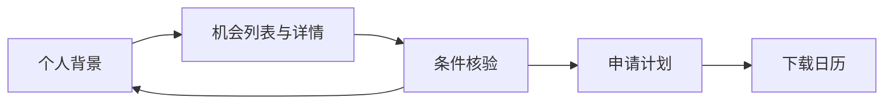

# PathFinder SJTU 首版页面结构

四个页面负责四个用户动作。桌面与移动端使用同一路由及数据。每一步都有明确的返回位置，刷新后可以接着使用已保存的个人背景和计划。



## 1. 个人背景 `/profile`

```text
个人背景                               [填入示例]
专业类别 [请选择]        年级 [请选择]
专业排名前 [    ]%       CET-6 成绩 [    ]
相关经历 [科研] [竞赛] [编程项目] [实习]
[确认暂无相关经历]
[清空背景]                            [保存并看机会]
```

- 未知字段可留空，标签未选时可明确选择“暂无相关经历”。输入不合法时，在对应字段下提示并保留已有输入。
- 从机会核验页返回这里补资料时，主操作改为“保存并返回核验”，保留来时选中的机会。

## 2. 机会列表与详情 `/opportunities`、`/opportunities/:id`

```text
机会                                   [全部 | 夏令营 | 校招]
┌ 机会列表 ────────────┐  ┌ 选中机会 ─────────────────┐
│ 先进计算夏令营        │  │ 先进计算夏令营        演示样例 │
│ 演示样例 · 12 月 12 日 │  │ 发布方 · 发布日期 · 截止日期    │
│ 数据开发实习          │  │ 公告摘录 / [查看原文]          │
│ 往期样例 · 已截止     │  │ 申请要求 · 材料清单            │
└───────────────────────┘  │                 [核验我的条件] │
                           └────────────────────────────────┘
```

- 桌面显示列表和详情。窄屏先展示列表，点开后进入独立详情，返回时保留筛选和滚动位置。
- 无来源链接的演示机会显示“虚构通知”与公告摘录。真实机会有链接时显示“查看原文”。
- 已截止仍可核验条件。详情和核验页都提示已截止，申请计划入口禁用。分类无结果时可点击“查看全部”。

## 3. 条件核验 `/opportunities/:id/check`

```text
先进计算夏令营 / 条件核验               [查看机会原文]
硬性条件    已满足 2 项 · 待核实 1 项
专业排名    已满足     要求前 20% · 你的排名前 12%
CET-6       待核实     要求至少 425 分 · 你尚未填写
专业类别    已满足     工科或理科 · 你填写的是工科
[逐项查看公告原文]
软性偏好    科研经历 [已有相关经历]
[补充个人背景]                          [生成申请计划]
```

- 结论、要求、用户值与原文出处需要在同一项中可查。移动端将并排信息堆叠成独立卡片。
- 无画像也能看到要求，涉及个人字段的判断显示“待核实”。刷新或修改画像返回后，结果用最新数据重新计算。
- 有硬性差距时，进入计划前展示差距摘要。计划中的准备事项仍可用于补齐条件或材料。

## 4. 申请计划 `/opportunities/:id/plan`

```text
先进计算夏令营 / 申请计划
申请目标日  12 月 12 日（来自公告）
准备任务                 提前天数        计划日期
联系老师准备推荐信       [7]            [12 月 05 日]
办理成绩单               [5]            [12 月 07 日]
核对并提交申请           —              12 月 12 日
[保存并确认计划]                          [下载 .ics]
```

- 有公告截止日时直接作为目标日。公告日期缺失时先请用户填写规划用目标日，再生成任务，并显示“自己设定”。
- 初始提前天数是估算。调整提前天数会重新倒推该任务的日期，手动改日期时保留调整结果并显示“手动调整”。
- 日期早于今天时显示“已过计划日期”，晚于申请目标日时指出具体冲突；提示放在对应任务旁。下载按钮在计划确认并通过日期检查后可用。
- 手机用纵向任务卡展示日期和天数，所有输入与操作无需横向滚动。
