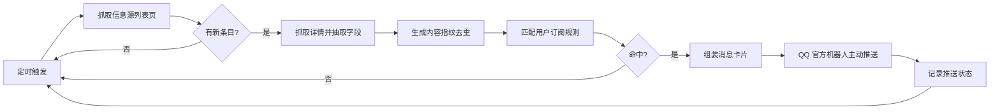

# 上海交通大学"交我创"智能体创新大赛——初赛作品设计方案

> **参赛赛道**：自由选题赛道
> **智能体名称**：信鸽 SJTU｜校园通知直达
> **参赛队伍**：星鹭企
> **方向定位**：信息聚合与主动推送（独立成篇，与同队 PathFinder 方向并列）

## 一、智能体简介

信鸽 SJTU 是一个"让通知去找人"的校园信息智能体。它持续监测学校、学院与就业部门发布的通知类信息，抽取标题、发布单位、发布日期、截止时间、适用对象等关键字段，按用户订阅的关键词、学院、年级与类别做个性化过滤，再通过 QQ 官方机器人主动推送到学生的单聊或群聊。

学生不需要每天刷新十几个网站，也不需要在群里等别人转发：符合条件的通知会在发布后数分钟内出现在 QQ 里，附带原文链接与截止倒计时。

一句话：**把"人找通知"变成"通知找人"。**

## 二、建设背景与应用场景

### 2.1 建设背景

上海交大的信息发布渠道高度分散：教务处、研究生院、各学院官网、学生就业服务和职业发展中心、图书馆、团委、社团……站点之间栏目结构不同、更新频率不同、发布时间不固定。

学生要拿到一条与自己相关的信息，通常要走四步：

1. 记得有哪些站点；
2. 定期逐个打开；
3. 在列表页里逐条判断是否与自己相关；
4. 记住截止日期。

第 2 步最容易被放弃。结果是"看到的时候已经截止"——这是学生反馈里最常见的一类信息损失。

现有替代方案各有缺口：

| 方案 | 缺口 |
|---|---|
| RSS | 校内多数站点不提供 |
| 公众号 | 覆盖不全，且需要主动点开 |
| 群转发 | 依赖热心人，滞后且不可控 |
| 通用搜索 | 搜不到"刚发布"的内容 |

信鸽 SJTU 针对的正是这个缺口：把周期性巡检交给机器，把相关性判断交给订阅规则，把送达交给学生已经在用的 QQ。

### 2.2 目标用户与场景

- **保研/考研学生**：夏令营、推免、复试通知
- **求职学生**：宣讲会、笔面试、企业专场
- **竞赛参与者**：报名开放与截止提醒
- **班级/社团负责人**：把本院通知转发到班级群
- **辅导员/教务老师**：把本部门通知定向推送给订阅学生

## 三、设计目标与功能范围

### 3.1 核心目标

用最低的使用成本，让"与学生相关的校园信息"在发布后尽快、准确地到达学生，并且**可追溯、可退订、不打扰**。

### 3.2 核心功能

1. **多源订阅**：内置常用信息源模板（教务处、研究生院、就业中心、图书馆等），支持用户自定义 URL 与解析规则。
2. **增量抓取与去重**：以"标题 + 链接 + 正文摘要"生成内容指纹，只推送新增条目；首次接入时只建立基线，不补推历史，避免刷屏。
3. **结构化抽取**：标题、发布单位、发布日期、截止日期、适用对象、原文链接。关键字段保留原文片段供核对。
4. **个性化过滤**：关键词（必须包含 / 排除）、学院、年级、类别；未命中的条目不推送。
5. **QQ 主动推送**：通过 QQ 官方机器人推送到单聊或群聊，消息为"标题 + 单位 + 截止时间 + 原文链接"的紧凑卡片。
6. **订阅管理**：`/subscribe`、`/unsubscribe`、`/list`、`/test` 指令；支持一键退订与静音时段。
7. **时效提醒**：截止前 3 天、1 天各补一条提醒（可关）。
8. **摘要（可选）**：调用大模型生成一句话摘要，明确标注"AI 摘要，以原文为准"，模型不可用时自动降级为原文首段。

### 3.3 初赛原型边界

为保障可行性，初赛只做一条闭环：

**选 3–5 个公开信息源 → 定时抓取 → 抽取与去重 → 关键词过滤 → 单聊主动推送**

演示脚本：现场在源站发布一条测试通知 → 60 秒内在 QQ 收到推送 → 点击链接回到原文。

以下列为后续拓展，不在初赛承诺：全校站点全覆盖、群聊推送、可视化配置界面、多用户 SaaS、动态渲染页面。

## 四、设计框架

### 4.1 系统模块

| 模块 | 职责 |
|---|---|
| 信息源适配层 | 每个站点一个适配器：请求、分页、列表解析、详情解析 |
| 抽取与标准化 | 字段抽取、日期归一、适用对象识别、原文片段留存 |
| 去重与状态 | SQLite 存内容指纹、首次推送时间、已推会话 |
| 订阅与过滤 | 用户订阅表（关键词/学院/年级/类别）、匹配打分 |
| 推送网关 | QQ 官方机器人 API 封装、频控、失败重试、降级 |
| 调度与运维 | 定时任务、健康检查、抓取失败告警 |
| 配置界面 | 初赛用配置文件；决赛做 WebUI |

### 4.2 主要工作流

## 五、技术路线

### 5.1 机器人框架

选用 **AstrBot**（AGPL-3.0 开源）。理由：

- 原生支持 QQ 官方机器人适配器，且有桌面客户端，可直接打包成 App；
- 插件体系允许在 `initialize()` 中启动后台任务，并暴露 `context.cron_manager`（基于 APScheduler）挂定时任务；
- 插件可声明 `requirements.txt`，依赖自动安装；
- 自带 WebUI，配置界面几乎白送。

抓取逻辑将写成**不依赖 AstrBot 的独立 Python 模块**，再用一层薄插件做适配——这样将来换框架或做 SaaS 时，核心代码不用动。

### 5.2 消息通道

选用 **QQ 官方机器人**，而非第三方协议端。理由：合规、不封号、有官方额度。

关键数据（来自 QQ 开放平台文档）：

| 场景 | 单关系频控 | 每日上限 |
|---|---|---|
| 单聊主动消息 | 20 条/分钟/用户 | 1000 条/天/用户 |
| 群聊主动消息 | 20 条/分钟/群 | 1000 条/天/群 |

对通知场景完全够用。两个必须处理的约束：

- 用户可在 QQ 客户端关闭「允许主动发送」，关闭后推送失败——需要明确提示，而不是静默丢消息；
- 群聊默认收不到全量消息，需要群管理员开启「机器人主动在群聊内发言」。

接入方式采用 **WebSocket 模式**：不需要公网服务器和备案域名，桌面 App 直接长连接即可。

### 5.3 抓取与解析

- 优先使用 RSS / JSON 接口；无接口时解析列表页与详情页；
- 使用 `httpx` 异步请求，带明确 UA、超时、重试与限速（单站点不低于 5 分钟一次）；
- 解析优先用 CSS 选择器（可配置），必要时用正则兜底；
- 动态渲染站点（SPA）作为可选项，用 Playwright 单独打包，不放进主安装包。

### 5.4 去重与存储

- 内容指纹 = `sha256(规范化标题 + 规范化链接 + 正文前 200 字)`；
- SQLite 三张表：`sources`（信息源）、`items`（条目与指纹）、`subscriptions`（订阅与推送记录）；
- 首次接入某源时只写基线不推送，避免一次刷出几十条历史。

### 5.5 部署形态

| 形态 | 说明 | 适用 |
|---|---|---|
| 桌面 App（主推） | 用户自己注册 QQ 机器人、填自己的 AppID/AppSecret，本地运行 | 个人用户，开源分发 |
| SaaS（后续） | 团队运营一个公共机器人，用户扫码即用 | 需要企业主体认证 |

桌面 App 形态是刻意选择：QQ 开放平台对**个人认证**的机器人限制"暂不支持公开使用"，但用户自己注册、自己使用的机器人完全合规。这既绕开了平台限制，也符合开源分发的定位。

### 5.6 验证方式

- 建一个 100 条的人工标注样例集，测抽取准确率；
- 用真实源跑 7 天，统计漏推/重推；
- 邀请 5–10 名同学试用，记录订阅数与退订原因。

## 六、资源需求

- **算力**：抓取与解析几乎不消耗算力，一台 1 核 2G 云主机或一台常开的个人电脑即可；大模型摘要为可选，可关闭。
- **模型**：仅在摘要功能使用，优先赛事提供的本地模型 API。
- **数据**：学校与学院公开页面；不采集需登录的内容。
- **开发**：Python 3.11+、AstrBot、httpx、SQLite、APScheduler。
- **人力**：信息源适配（主要工作量）、规则与过滤、推送与运维、测试与文档。

## 七、预期效果与评估指标

### 7.1 预期效果

- 学生从"每天刷 5 个站"变成"看 QQ 里的 3 条推送"；
- 关键截止日期不再依赖记忆；
- 班级群转发从"人工搬运"变成"一键订阅"。

### 7.2 原型评估指标

| 指标 | 目标 |
|---|---|
| 字段抽取准确率 | ≥ 90%（100 条人工核验） |
| 重推率 | 0 |
| 漏推率 | < 5% |
| 端到端延迟（发布 → 推送） | P95 < 5 分钟 |
| 推送到达率 | > 98% |
| 试用用户 7 日留存 | ≥ 60% |

指标阈值在样例集建立后校准，如实报告，不预先承诺未测结果。

## 八、风险与伦理合规考虑

1. **站点条款与反爬**：只抓公开页面，遵守 robots.txt 与站点条款，不绕过登录与访问控制，单站点抓取间隔不低于 5 分钟，UA 标明用途并提供联系方式。
2. **内容版权**：推送只含标题、发布单位、截止时间与原文链接，**不搬运全文、不转载图片**。
3. **个人信息**：只保存 QQ 机器人返回的 openid，不保存 QQ 号、手机号；提供一键删除订阅与数据。
4. **平台规范**：QQ 开放平台要求机器人"功能不能过于简单、不应与其他机器人同质化"，且"不得关联至不具备完整授权的网站"。因此产品定位为**用户自选信息源的通用订阅工具**，而非"某网站的官方通知机器人"。
5. **推送失败**：用户关闭主动发送、群聊未开启主动发言、频控触发时，都要给出可读的失败原因与修复指引。
6. **误推与漏推**：提供"我漏了一条"反馈入口，用于持续校准解析规则。
7. **AI 摘要风险**：摘要可能失真，必须标注"AI 摘要，以原文为准"，并在模型不可用时降级。

## 九、迭代计划

| 阶段 | 目标 |
|---|---|
| 初赛 | 3–5 个源 + 单聊推送闭环 + 演示脚本 + 样例集 |
| 决赛 | 多源、群聊、WebUI 配置、时效提醒、部署为可试用服务 |
| 后续 | SaaS 化、多平台（企微/飞书/Telegram）、与 PathFinder 打通 |

最后一条值得展开：信鸽负责"把机会捞进来"，PathFinder 负责"判断适不适合、什么时候准备"。两个方向在数据层天然衔接——信鸽抓到的结构化条目可以直接作为 PathFinder 的机会库输入。

## 十、与 PathFinder 方向的边界

为避免同队两个方向重叠，明确划分：

| 维度 | 信鸽 SJTU（本方向） | PathFinder SJTU（同队另一方向） |
|---|---|---|
| 核心问题 | 信息**到达**：怎么让人及时看到 | 信息**决策**：看到之后怎么判断与准备 |
| 输入 | 网站页面 | 用户画像 + 机会条目 |
| 输出 | QQ 推送 | 匹配报告、待办清单、日历 |
| 关键技术 | 抓取、抽取、去重、推送 | 规则匹配、RAG、排期 |
| 成功标准 | 不漏、不重、够快 | 判断准、可解释、可执行 |

两者的接口是"结构化机会条目"：信鸽产出，PathFinder 消费。

---

**作品定位一句话**：信鸽 SJTU 把分散在几十个校园网站里的通知，变成 QQ 里几条及时、准确、可退订的推送。
