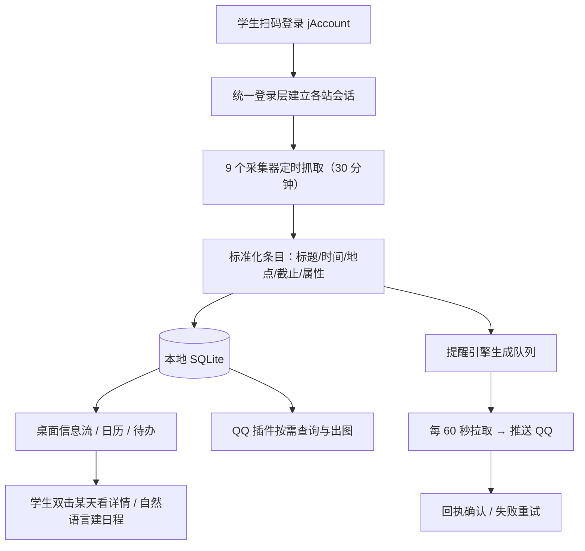

# 上海交通大学“交我创”智能体创新大赛——初赛作品设计方案

> **参赛赛道**：自由选题赛道
> **智能体名称**：信鸽 SJTU｜校园信息中枢
> **参赛队伍**：星鹭企
> **队伍成员**：胡昕宇、丁天宇、石璟阳
> **联系邮箱**：1847627339@qq.com

## 一、智能体简介

信鸽 SJTU 是面向上海交通大学学生的**校园信息中枢**。它把分散在 Canvas、教务、好大学在线、知途好课、物理实验、第二课堂、学院官网、水源社区和校园邮箱里的信息，统一抓取、去重、归档到一个桌面工作台中，并在该提醒的时候，通过 QQ 机器人把提醒主动送到学生手上。

学生只需要**扫码登录一次 jAccount**，之后不用再逐个网站翻：作业截止、活动报名、学院通知、课程消息都汇到一处，日程自动铺进日历，到点自动推送。所有数据保存在本机，抓取的是**用户本人**的校园信息。

目前系统已实现并在真实账号上跑通：**9 类信息源、94 个后端接口、17 个 QQ 指令、8 类主动推送**。

## 二、建设背景与应用场景

### 2.1 建设背景

交大学生的信息分散程度远超一般预期。一门课的作业在 Canvas，测验在好大学在线，实验安排在物理实验网站，通识讲座在第二课堂平台，学院通知在学院官网，同学讨论在水源社区，正式通知还可能在校园邮箱里。这些系统彼此不连通，登录方式、更新节奏、信息结构各不相同。

由此产生三个具体问题：

1. **信息发现的成本极高。** 学生要在六七个网站之间轮换查看，且每个网站的“新消息”入口位置都不一样。漏看一次作业公告、错过一次报名（第二课堂活动名额常在开放当天报满），代价都很直接。
2. **信息只有“看到”，没有“落到日程”。** 即使看到了“12-02 17:59 提交”，也需要手动复制到日历。多数学生实际并不维护日历，于是靠记忆和临时反应，临近截止才开始处理。
3. **提醒是被动的。** 所有平台都需要学生主动打开才能看到更新。真正需要的是“到点主动来告诉你”，而现成的校园工具普遍不提供这种能力。

通用问答类工具能解释信息，但它无法持续、稳定地访问这些需要登录的校内系统，也不会替学生盯着截止时间。**信鸽 SJTU 因此聚焦一条完整链路：抓取 → 归档 → 结构化 → 排进日程 → 到点提醒。**

### 2.2 目标用户与场景

- **在校本科生与研究生**：课程作业、实验报告、慕课测验多线并行，需要一处集中查看、按时提醒。
- **活动参与者**：需要及时发现有劳动学时、新时代讲座属性的第二课堂活动，并记住报名截止时间（名额有限，常需抢报）。
- **学生干部与班委**：需要快速了解学院公告，转发或统计。
- **希望减少重复操作的学生**：不想每天轮换登录六七个网站。

典型场景：

> 晚上在图书馆，手机 QQ 收到一条消息：「⏰ 1 小时后 · 图书馆开会 / 15:00 图书馆」。这是下午随口说的一句「明天下午3点图书馆开会」被自动解析成了日程；第二天早上 07:30 又收到一条「☀️ 今天 3 件事」，把当天要交的作业和要开的会一次列清。

## 三、设计目标与功能范围

### 3.1 核心目标

把学生的校园信息从**多个需要主动访问的网站**，变成一个**本地的、结构化的、会主动提醒的信息中枢**。系统提供信息汇总与提醒辅助，不替学生做决策，不代替学校部门的正式通知。

### 3.2 核心功能

1. **统一信息流（9 类信息源）**
   Canvas 课程公告与作业、好大学在线消息与测验、知途好课作业、物理实验安排、第二课堂活动（约 300 条在架）、学院公告（约 430 条）、水源社区帖子、校园邮箱、自定义 RSS。统一归档到本地数据库，支持按板块浏览、只看未读、多选、批量已读、搜索。

2. **日历与日程**
   月视图日历自动铺上作业截止与手动日程；已完成的条目以删除线保留而非消失；**双击任意一天**展开当天全部安排（时间段、标题、类型、地点）。提供四种建日程方式：活动卡片「加入日程」、活动详情弹窗、右栏自然语言输入、QQ 对话。

3. **自然语言交互**
   不用记指令。学生可以直接说：
   - 建日程：「明天下午3点图书馆开会」「下周一上午9点上机实验，东上院308」「11月30日中午12点半 体检」
   - 查信息：「最近有什么作业」「明天有什么安排」「今天有课吗」
   - 按属性查活动：「有哪些有劳动学时的活动」「有新时代讲座的活动吗」
   - 改提醒设置：「提醒提前一小时」「每天晚上十点以后别推」

   时间与地点解析采用**确定性规则**（支持「点半/一刻/三刻」、不带「在」的楼号等中文口语），不依赖大模型，因此零幻觉、响应在毫秒级。

4. **8 类主动推送**
   这是本作品与“信息聚合类工具”的核心区别——**不需要学生主动打开任何东西**：

   | 类型 | 触发时机 |
   |---|---|
   | 日程提醒 | 开始前 60 分钟 |
   | 作业提醒 | 截止前 24 小时 + 2 小时 |
   | 邮件提醒 | 新邮件到达（30 分钟巡检），带发件人与主题 |
   | 每日早报 | 每天 07:30，汇总当天日程与截止作业 |
   | 公告汇总 | 每晚 20:00，有新增才推 |
   | 新活动 | 发现新活动时推送**图片**（含劳动学时等标签） |
   | 登录过期告警 | jAccount 失效时，附带「点哪里重新登录」的操作指引 |
   | 抓取失败告警 | 某信息源连续 3 轮失败时 |

   推送带完整工程约束：静默时段（默认 01:00–07:30）、每小时限流、过期内容自动丢弃、多条合并补推、失败重试，全部可在 App 或 QQ 中用自然语言调整。

5. **多模态输出**
   QQ 里可以直接要图：`/日历` 出月/周/日三种密度的日历图；`/活动图 2` 出第 2 条活动的**整页详情截图**（含海报、主讲人、报名要求）；新活动通知本身就是一张自动渲染的清单图。学生不用点链接就能判断“这个活动值不值得去”。

6. **十三家模型供应商**
   支持 OpenAI、Anthropic、DeepSeek、Kimi、智谱、通义、火山方舟、硅基流动、OpenRouter、Groq、本地 Ollama 等，选择供应商后自动带出接口地址与常用模型，学生只需填 API Key。赛事提供的“致远一号”属于 OpenAI 兼容接口，可直接接入。

### 3.3 初赛原型边界（已完成 / 规划中）

**已完成并在真实账号上验证：**

- 9 类信息源接入，jAccount 一次扫码打通全部校内站点
- 94 个后端接口、17 个 QQ 指令、8 类主动推送
- 桌面端（Electron + Python）与便携版（免安装）双形态
- 日历、日程、活动属性筛选、邮件、搜索、诊断、订阅管理
- Windows 安装包与 Linux 部署脚本

**规划中：**

- 培养方案学分核查与选课辅助（与团队另一作品方向一致，可复用同一套文档解析能力）
- 群聊推送（需处理 QQ 官方群消息的会话缓存限制）
- 校园卡、图书馆座位等更多校内服务接入
- 移动端

## 四、设计框架

### 4.1 系统模块

- **桌面交互层**：Electron 壳承载原生 HTML/CSS/JS 界面，负责窗口、生命周期与后端子进程管理。
- **后端服务层**：FastAPI + SQLite，提供 94 个 REST 接口与 WebSocket 实时推送，负责抓取调度、数据归档、提醒队列与图片渲染。
- **信息采集层**：9 个独立采集器，统一抽象为“登录态 → 请求 → 解析 → 标准化条目”，各站点差异被封装在采集器内部。
- **统一登录层**：一次 jAccount 扫码，通过 SSO 跳转链为各站点建立会话，会话按站点分别持久化。
- **提醒引擎**：后端生成提醒队列（按规则、去重、静默顺延、限流），QQ 插件每 60 秒拉取并推送，推送成功后回执确认。
- **智能体层**：AstrBot 承载 QQ 官方机器人，插件以三层优先级处理消息——指令（/）→ 自然语言改设置 → 自然语言查询 → 自然语言建日程 → 兜底上报。
- **安全与审计层**：凭据本地存储、API 脱敏回显、抓取失败与登录失效的主动告警。

### 4.2 主要工作流

## 五、技术路线

1. **抓取与登录**
   采用真实浏览器（Playwright）+ 本机 Edge/Chrome 完成需要 JS 渲染或 SSO 跳转的站点登录，会话按站点持久化；对提供标准协议或开放接口的站点（Canvas REST、IMAP/Zimbra）优先走协议层，避免过度依赖页面结构。所有请求带缓存与失败重试。

2. **规则优先、模型兜底**
   时间地点解析、提醒规则、去重、静默与限流全部由确定性代码实现，保证**零幻觉与毫秒级响应**；仅在开放式问答（如「选课什么时候开始」）时才调用大模型。这一取舍来自实测：走大模型单次要 25–60 秒且存在多余工具调用，而规则解析 0.2 秒且结果可复现。

3. **推送可靠性设计**
   提醒以“队列 + 回执”实现：后端只负责生成到期提醒，插件拉取后发送并确认，未确认自动重试。过期超过 24 小时的内容直接丢弃，24 小时内的合并成一条补推；静默时段内的提醒顺延而非丢弃。

4. **多模态渲染**
   日历图、活动清单图由 Pillow 直接绘制，活动详情图由无头浏览器整页截图，均带缓存，避免重复渲染开销。图片作为独立消息段发送，与文字解耦——图片失败不影响文字送达。

5. **工程形态**
   桌面端与便携版共用同一份源码：便携版内置 Python 运行时与依赖包，解压即用，不需要学生安装环境。一键部署脚本负责源码同步、Electron 资源包重打包与重启。

6. **验证方式**
   项目内置两套可重复执行的验收脚本：提醒系统 9 项、界面交互 4 组，均自动清理测试数据并校验数据库计数回到基线。推送链路以真实 QQ 账号完成端到端验证。

## 六、资源需求

- **算力与模型**：默认使用赛事提供的“致远一号”本地大模型 API（OpenAI 兼容），数据不出校；日常运行中模型调用量极低，只有开放式问答会走模型，规则解析不消耗模型额度。
- **部署环境**：学生本机为主（桌面端/便携版），无需服务器即可使用全部功能；可选校内云主机做常驻部署（已在校内服务器上完成部署验证）。
- **数据来源**：学生**本人**在授权范围内可访问的校园系统；通过用户自己的 jAccount 正常登录，等价于用户本人手动访问，不绕过任何访问控制、不破解验证码、不共享账号，抓取频率（30 分钟一轮）远低于人工访问强度。
- **开发工具**：Electron、FastAPI、SQLite、Playwright、Pillow、AstrBot（QQ 官方机器人框架）。
- **团队分工**：场景调研与产品设计、采集器开发、后端与提醒引擎、前端交互、QQ 机器人与运维测试。
- **运营维护**：各站点页面结构变化时需要更新采集器；登录失效由系统主动告警提示用户重新登录。

## 七、预期效果与评估指标

### 7.1 预期效果

- 学生每天主动查看校园网站的次数从 5–7 次降到 0–1 次，信息不漏看。
- 作业与活动截止不再依赖记忆，而是由系统在合适的时间点主动推送。
- 作业截止自动进入日历，学生第一次拥有完整可用的学期日程视图。
- 学生可以在 QQ 里用自然语言完成查询、建日程、改设置，不需要学习任何指令。

### 7.2 原型评估指标

| 维度 | 指标 | 当前实测 |
|---|---|---|
| 覆盖度 | 接入信息源数量 | 9 类 |
| 功能面 | 后端接口 / QQ 指令 / 推送类型 | 94 / 17 / 8 |
| 抓取准确性 | 单源解析条目数 | Canvas 96、活动 300、学院公告 430 |
| 提醒可靠性 | 端到端送达时延 | 绑定后 53 秒内送达；队列回执确认 |
| 解析准确率 | 自然语言建日程（含口语时间、无介词地点） | 6/6 例句日期时间地点全对 |
| 响应速度 | 规则解析 vs 模型问答 | 0.2 秒 vs 25–60 秒 |
| 稳定性 | 提醒系统自动化验收 | 9/9 通过 |

## 八、风险、安全与伦理合规

### 8.1 数据与隐私

1. **只处理用户本人数据。** 所有校园系统均通过**用户自己的 jAccount 正常登录**后访问，读取的是用户本人可见的内容，等同于用户本人手动打开网页。系统不采集他人信息、不采集成绩与身份证件、不批量导出、不再分发。
2. **邮件正文从不读取。** 邮箱采集只取**发件人与主题**（IMAP 使用 `BODY.PEEK[HEADER]`），正文不下载、不入库、不过模型。这一点比多数同类作品更克制，是本作品的隐私设计选择。
3. **数据只存本机。** 会话凭据、抓取内容、日程全部保存在用户本机用户目录（`~/.xinge`），不上传任何自建服务器；服务端不保存任何用户数据。
4. **可导出、可删除。** 提供「导出我的全部数据」（导出时自动剔除密钥）与「删除我的全部数据」两个入口；退出登录会同时清除各站点会话与所有敏感凭据。

### 8.2 模型与数据流向

1. **默认使用校内模型。** 默认接入赛事提供的「致远一号」本地大模型 API（OpenAI 兼容），数据不出校。第三方模型（DeepSeek、Kimi、通义、Ollama 等）仅在用户**主动选择**时启用，安装向导中说明数据流向。
2. **模型调用量最小化。** 时间解析、提醒规则、去重、限流全部由确定性代码完成，不经过模型；只有开放式问答才会调用模型，且 prompt 中不包含邮件正文、不包含身份信息。
3. **关闭第三方遥测。** 启动 AstrBot 时通过环境变量关闭其匿名统计上报，避免携带设备标识的请求外发。

### 8.3 访问控制与工程安全

1. **服务只监听本机回环地址。** 后端与机器人面板默认仅绑定 `127.0.0.1`；如需局域网访问，必须显式开启并配置访问令牌。
2. **敏感配置脱敏回显。** 所有涉及密钥、口令、会话的接口返回一律脱敏，界面不展示明文。
3. **模型地址白名单。** 只允许写入内置供应商目录中的接口地址，防止配置被改写后导致凭据外发。
4. **传输安全。** 邮箱 IMAP 强制校验证书；校内接口优先 HTTPS，不接受自签证书。
5. **凭据存储最小化。** 敏感文件在用户目录下以受限权限保存；除本地外不做任何备份或同步。
6. **开源合规。** 本项目基于 AstrBot（AGPL-3.0），按 AGPL-3.0-or-later 发布，保留上游全部许可与声明文件，附 `LICENSE` 与 `THIRD_PARTY_NOTICES.md`。

### 8.4 信息准确性与边界

1. **所有条目保留原文链接与发布时间**，用户可一键跳转核实；系统不改写官方通知内容。
2. **平台没有的字段如实告知。** 例如活动属性只提供「劳动学时」与「新时代讲座」，用户问「素拓分数」时明确回复平台不提供，不编造数据。
3. **模型输出标注。** 确定性规则解析不涉及模型幻觉；开放式问答明确标注为模型生成，不作为官方依据。
4. **提醒适度性。** 内置静默时段、每小时限流、过期内容丢弃与合并补推，避免打扰；用户可随时关闭推送。
5. **校园服务边界。** 系统只做信息汇总与提醒，不代替学校部门办理业务，不声称与教务或校务系统打通。
6. **个人自用形态。** QQ 机器人为用户自行注册、自行使用，使用 QQ 开放平台的官方接口，不面向公众提供服务。

### 8.5 已知限制（如实说明）

- 各站点页面结构变化时需要更新采集器；个别站点（如好大学在线）登录状态保持时间较短，失效时系统会主动告警提示重新登录。
- QQ 官方接口只提供用户 openid，无法直接以 QQ 号定位；推送对象需由用户在应用内选择或首次对话后自动绑定。
- 群聊主动推送受平台会话机制限制，当前版本仅支持私聊推送。

## 九、迭代计划

- **初赛阶段（已完成）**：完成 9 类信息源接入、统一信息流、日历与日程、自然语言交互、8 类主动推送、图片输出，并在真实账号上完成端到端验证；产出桌面端与便携版两种形态。
- **决赛阶段**：接入赛事“致远一号”模型；补充培养方案核查与选课辅助；完善数据导出与一键清除；做小范围真实用户试用，收集漏看率与推送满意度。
- **后续拓展**：群聊推送、更多校内服务（图书馆、校园卡）、移动端、以及面向其他高校的可复用版本。

---

**作品定位一句话**：信鸽 SJTU 把交大学生散落在九个校园系统里的信息收进本机，并在该提醒的时候主动送到手边——让每条通知都能落到日程上，让每个截止都不再靠记忆。

---

> **声明**：本作品为上海交通大学"交我创"智能体创新大赛参赛作品，由学生团队（星鹭企）独立开发，
> **非上海交通大学官方产品或服务**。项目中使用的校园系统名称、标识仅用于说明数据来源。
>
> **开源许可**：本项目基于 AstrBot（AGPL-3.0）构建，整体以 AGPL-3.0-or-later 发布。
> 详见仓库根目录 `LICENSE` 与 `THIRD_PARTY_NOTICES.md`。