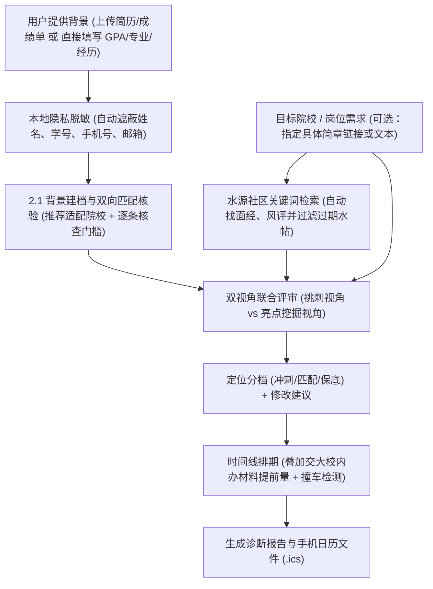
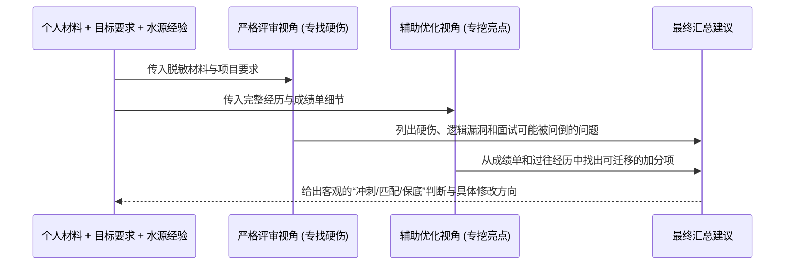

# 上海交通大学“交我创”智能体创新大赛——初赛作品设计方案

> **参赛赛道**：自由选题赛道（开放式命题）\
> **作品名称**：PathFinder SJTU —— 面向交大学子的“推免 / 申研 / 求职”全周期材料诊断与规划助手\
> **参赛队伍**：`[待填写：队伍名称]`\
> **队伍成员**：`[待填写：1-4名成员姓名、学院及分工]`\
> **联系邮箱**：`[待填写：队长交大邮箱]`\

---

## 一、 项目背景与痛点分析（场景实用性）

每到保研夏令营、海外申研和秋招季，交大同学普遍会同时面对几十个项目和岗位，实际准备中经常遇到四个很现实的麻烦：

1. **只看官方简章不够，真实行情全靠“大海捞针”**\
   官网通知里通常只写“成绩优异、英语良好”这类宽泛要求，但实际上往年卡到多少排名、面试喜欢问什么、某个实验室或岗位口碑如何，往往都散落在**水源社区**的讨论帖里，人工一条条翻非常费时间。
2. **普通 AI 改简历只会“说好听的”，抓不住真问题**\
   直接把简历丢给通用大模型，它往往只会顺着你的话夸，或者给出泛泛的套话润色，很少像真正的面试官或招生老师那样指出“你这里时间线对不上”“这段经历和目标方向不搭”“面试官看到这里一定会追问什么”。
3. **跨专业或不同材料之间容易“打架”**\
   简历里写的项目、成绩单上的专业课成绩、以及手头的作品集/论文材料经常没有串联起来，很多同学投递前甚至没发现自己的硬性条件已经触线。
4. **多线并行容易忘事、时间撞车，还常漏掉校内办手续的时间**\
   不同学校的夏令营、笔面试经常挤在同一周，很多同学只盯着网申截止日期，却忘了**交大校内打成绩单/排名证明、开在读证明、找老师沟通推荐信**都需要提前好几天，临近截止才手忙脚乱。

**我们的思路**：\
做一个**贴合交大校园实际**的智能体，不搞“一问一答”的聊天套壳，而是把**个人材料核查、水源社区信息检索、双视角挑刺评估、以及日程冲突提醒**串成一条完整的工作流，真正帮同学省时间、少踩坑。

---

## 二、 整体方案与核心功能（方案可行性）

系统基于学校提供的**“致远一号”本地大模型 API** 和校内云主机搭建，所有敏感信息先在本地脱敏再处理，整体流程如下：

### 2.1 基于个人背景的“院校匹配”与“条件核验”（核心入口）
围绕用户最关心的两个核心问题——**“以我的条件能申哪些学校/岗位”**和**“我到底满不满足某个心仪项目的要求”**，系统设计了**个人背景建档 + 双向匹配核验**引擎（全专业通用，不强求代码背景）：

1. **个人背景（Background）一键建档**
   - 用户既可以直接上传 PDF/Word 格式的**个人简历与成绩单**由系统自动提取，也可以通过表单直接填写或补充关键背景：本科专业与方向、GPA/专业排名百分比、英语成绩（四六级/托福/雅思）、科研/竞赛/实习经历，以及意向地区或发展方向。
2. **模式一：由背景找目标——“我适合去哪？”（智能匹配推荐）**
   - 当用户还没有明确目标时，系统将用户的个人背景与**院校/项目要求库**及**水源社区往届去向经验**进行多维度比对（硬性分数线过滤 + 专业方向与经历相关性打分）。
   - 自动输出一份分档推荐清单，按**“冲刺 / 匹配 / 保底”**列出适配的院校、院系或企业岗位，并逐一说明推荐理由（例如：“你的排名处于该校往年录取中位，且有相关科研经历，属于稳妥匹配档”）。
3. **模式二：由目标查自身——“我够不够格？”（逐条门槛核验）**
   - 当用户指定了某一所目标院校或粘贴了具体招生简章/岗位 JD 时，系统会自动把大段文字拆解为两张清单：
     - **硬性门槛清单**：如院校层次要求、专业排名百分比上限、英语单科/总分线、先修课学分要求、特定材料限制（如是否必须提供推荐信或夏令营资格）。
     - **软性偏好清单**：如是否看重特定科研方向、竞赛奖项或相关实习经验。
   - 系统逐条对照用户的 Background 给出明确结论：**`已满足` / `存在风险（如差几分或材料待补）` / `明确不满足`**，并给出具体差距说明与可行的补救建议（如刷新英语成绩、补充先修课证明或转向同校相近项目）。
4. **附加材料辅助印证（按需可选）**
   - 如果用户额外提供了论文摘要、获奖证明、作品集，或者工科同学提供了 GitHub/GitLab 代码仓库链接，系统会一并纳入背景评估，作为经历真实性与加分项的补充依据；不提供也不影响上述核心匹配与核验流程。

### 2.2 水源社区关键词检索与经验整理（交大特色）
- **关键词自动检索**：根据用户填写的目标学校、院系、导师或公司岗位，智能体会自动整理常用简称和关键词，去**水源社区**检索相关的公开讨论帖和历史面经。
- **过滤水帖与标明出处**：论坛帖子有新有旧，也有不少主观情绪发言。系统会优先筛选近一两年的高赞、高回复经验贴，把“往届真实卡位情况、常见面试问题、注意事项”提炼出来，并**附上原帖链接和发帖时间**方便用户自己核实，不瞎编。

### 2.3 “挑刺 + 挖亮点”双视角联合评审
为了避免大模型只会客套夸人，我们把评审拆成两个互补的角色依次分析，最后再汇总：

### 2.4 贴合交大节奏的排期与撞车提醒
- **把校内办手续的时间算进去**：内置交大常见材料的常规办理耗时（如成绩单/排名证明、在读证明、找导师签字或写推荐信等）。如果某项目离截止很近，系统会自动往前倒推提醒“最晚哪天得去办材料”。
- **撞车检测与取舍建议**：用程序算法精确检查多个笔试、面试和考试周是否冲突；一旦撞车，会结合前面的匹配度评估，直接告诉用户“哪个更稳、哪个是冲刺”，辅助做取舍。
- **一键导入手机日历**：所有截止日期和前置提醒可以一键导出成标准的 `.ics` 文件，直接导入手机日历、Outlook 或飞书。

### 2.5 目标页面变更提醒（可选扩展）
- 对于用户特别关注的几个公开招生页面，系统支持定期做一次轻量检查，如果发现报名时间提前或通知更新，及时提醒用户调整排期。

---

## 三、 安全与隐私保护设计

简历和成绩单里全是个人隐私，我们在设计上把安全放在第一位：

1. **本地自动脱敏**：文件解析后，在送给大模型之前，本地程序会先把**姓名、学号、身份证号、手机号、邮箱**替换成占位符（如 `[学号]`、`[手机号]`），模型看不到真实身份信息，结果返回后再在本地还原显示。
2. **用完不留存**：用户上传的简历、成绩单只在当次会话中临时处理，分析完成后自动清理，不保存用户隐私原件。
3. **水源社区合规访问**：严格遵守水源社区的访问规范和频率限制，只在合法授权或公开板块范围内做关键词检索，不搞高频爬虫，也不收集发帖人的个人隐私。
4. **防恶意文本干扰**：对外部抓取的网页或论坛内容做隔离处理，防止里面夹杂奇怪的指令干扰智能体正常工作。

---

## 四、 校内推广价值与后续扩展（推广可能性）

- **全校都能用，需求实打实**：不管是本科生保研、出国，还是研究生找工作，每年都要经历这一套流程。接上**水源社区**的校内经验和**交我办**的校内服务后，实用性比市面上通用的商业 AI 工具高很多。
- **一套框架可以复用到其他校园事务**：这套“核对个人材料 + 查校内经验 + 算时间冲突 + 导出日历”的思路，后续稍作调整就能用在奖学金申报、大创结题提醒等其他校园场景里，适合在“交我办”长期运行维护。
